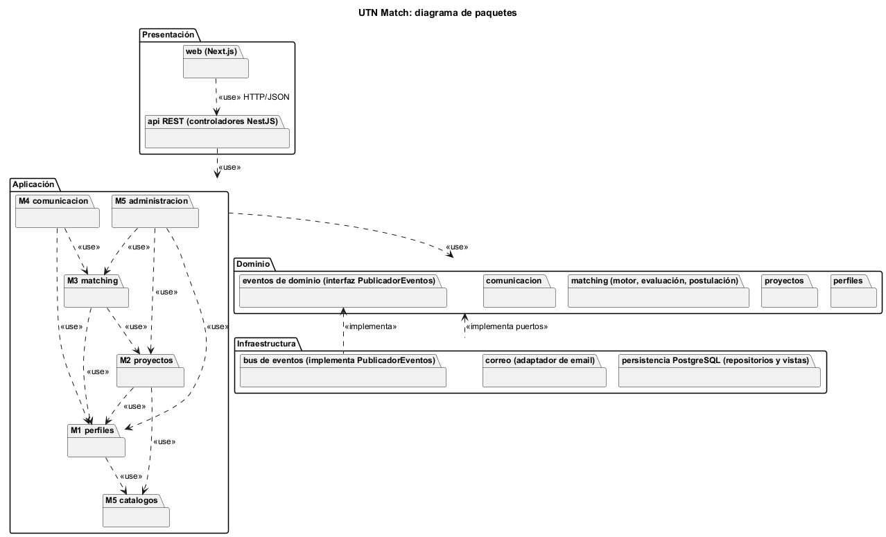

# UTN Match: arquitectura

Trabajo Final Integrador, Tecnicatura Universitaria en Programación (UTN). Entrega 2: Diseño y Módulos.

## 1. Introducción

UTN Match es un monolito modular en cuatro capas: una sola aplicación NestJS dividida en los cinco módulos de la Entrega 1, cada uno organizado internamente por capas. Elegimos un monolito y no microservicios porque la Entrega 1 plantea evitar arquitecturas complejas para un problema de este tamaño. El diseño sigue tres reglas:

1. Las dependencias entre capas apuntan hacia el dominio.
2. Un módulo no lee ni escribe las tablas de otro: usa su API (un servicio exportado) o escucha sus eventos.
3. Cada tabla tiene un único módulo dueño (sección 4 de [MODULOS.md](./MODULOS.md)).

## 2. Capas

- Presentación: la aplicación Next.js con React y los controladores REST de NestJS. Recibe pedidos y valida su formato, pero no aplica reglas de negocio.
- Aplicación: los servicios de NestJS de cada módulo. Coordinan los casos de uso, autorizan, manejan transacciones y emiten eventos. Son la API que cada módulo ofrece a los demás.
- Dominio: las reglas de negocio en TypeScript puro, sin dependencias de NestJS ni de la base. Incluye la máquina de estados de la postulación, las funciones del motor, las definiciones de los eventos y las interfaces que el dominio necesita del exterior: los repositorios y `PublicadorEventos`.
- Infraestructura: los repositorios sobre PostgreSQL, el adaptador de email y el bus de eventos, que implementa `PublicadorEventos` con `@nestjs/event-emitter` y recibe los eventos para pasárselos a los servicios de aplicación.

En lugar de que el dominio llame a la base, el dominio define la interfaz que necesita (por ejemplo, `MatchRepository`) y la infraestructura la implementa. Con los eventos pasa lo mismo: los servicios publican a través de `PublicadorEventos` y no conocen la librería de eventos. Esto agrega una interfaz por repositorio, pero permite probar el motor sin base de datos (RNF-07) y cambiar de ORM sin tocar el dominio.

## 3. Diagrama de paquetes



La imagen se generó con [diagramas/paquetes.puml](./diagramas/paquetes.puml) (PlantUML). El mismo diagrama está en [diagramas/paquetes.uxf](./diagramas/paquetes.uxf), que se abre en UMLetino con File > Open.

Cada flecha `<<use>>` va desde el paquete que usa hacia el paquete usado. Entre capas, las dependencias bajan de Presentación a Aplicación y de Aplicación a Dominio, e Infraestructura también apunta a Dominio porque implementa sus interfaces; el dominio no depende de ninguna otra capa. Dentro de la capa de aplicación no hay ciclos: los catálogos de M5 y M1 son la base, y ningún módulo depende de M4 ni de la administración de M5. Los eventos no se dibujan como dependencias entre módulos, porque quien los emite no conoce a quien los escucha. La interfaz `PublicadorEventos` está en el paquete de eventos de dominio y la implementa el bus de eventos de Infraestructura.

## 4. Módulos

Para cada módulo se indican su responsabilidad, su contrato (el servicio que exporta y los eventos que emite) y lo que encapsula. Los tipos `Dto` son objetos de solo lectura: nunca se expone una fila de la base.

### 4.1 M1: Autenticación y Gestión de Perfiles

Responsabilidad: la identidad de cada usuario (quién es, qué rol tiene y qué ofrece).

```ts
interface PerfilesApi {
  obtenerUsuario(idUsuario: number): Promise<UsuarioResumenDto>;
  obtenerPublicador(idUsuario: number): Promise<PublicadorDto>;
  listarPerfilesParaMatching(filtro?: { idsEstudiante?: number[] }): Promise<PerfilMatchingDto[]>;
  desactivarUsuario(idUsuario: number): Promise<void>;
  cambiarRol(idUsuario: number, rol: Rol): Promise<void>;
  contarEstudiantesActivos(): Promise<number>;
}
```

`PerfilMatchingDto` tiene solo lo que necesita el motor: año, horas semanales, tecnologías con nivel y el texto del perfil. Emite `perfil.actualizado`. Encapsula el manejo de contraseñas y tokens, la validación entre rol y perfil, y sus tablas.

### 4.2 M2: Gestión de Proyectos

Responsabilidad: la oferta (qué proyectos existen, quién los publicó y en qué estado están).

```ts
interface ProyectosApi {
  obtenerProyecto(idProyecto: number): Promise<ProyectoResumenDto>;
  listarProyectosParaMatching(filtro?: { idsProyecto?: number[] }): Promise<ProyectoMatchingDto[]>;
  buscarPublicados(filtros: FiltrosBusquedaDto): Promise<ProyectoResumenDto[]>;
  esResponsable(idUsuario: number, idProyecto: number): Promise<boolean>;
  suspender(idProyecto: number, motivo: string): Promise<void>;
  contarPorEstado(): Promise<Record<EstadoProyecto, number>>;
}
```

Emite `proyecto.publicado`, `proyecto.actualizado` y `proyecto.estado_cambiado`. Encapsula las transiciones de estado del proyecto y la regla de publicador único.

### 4.3 M3: Búsqueda y Recomendación (Matching)

Responsabilidad: la vinculación entre estudiantes y proyectos (compatibilidad, postulaciones y evaluación del motor).

```ts
interface MatchingApi {
  recomendacionesParaEstudiante(idEstudiante: number, limite: number): Promise<RecomendacionDto[]>;
  recomendacionesParaProyecto(idProyecto: number, limite: number): Promise<RecomendacionDto[]>;
  ultimasEvaluaciones(): Promise<EvaluacionDto[]>;
}

interface PostulacionesApi {
  obtenerSeguimiento(idPostulacion: number): Promise<SeguimientoDto>;
  listarPostulacionesDeEstudiante(idEstudiante: number): Promise<PostulacionResumenDto[]>;
}
```

Emite `match.nuevo`, `invitacion.enviada`, `postulacion.creada` y `postulacion.estado_cambiado`, y escucha los eventos de M1 y M2 para recalcular. Cuando un estudiante acepta una invitación, M3 crea la postulación en estado pendiente en la misma operación. Encapsula la fórmula del puntaje, los algoritmos de similitud, la máquina de estados de la postulación y el cálculo de las métricas de evaluación.

### 4.4 M4: Comunicación y Seguimiento

Responsabilidad: avisar lo que pasó y permitir seguir las postulaciones. No exporta servicios: escucha los eventos de M2 y M3 y usa las API de M1 y M3. Encapsula las plantillas y el proveedor de email.

### 4.5 M5: Administración y Reportes

Responsabilidad: moderar, mantener los catálogos y mostrar las métricas. Se divide en tres submódulos: `catalogos`, que no depende de nadie y exporta `CatalogosApi` (listar y validar tecnologías, habilidades y materias) para M1 y M2; `admin`, que modera a través de las API de M1 y M2; y `reportes`, que usa las vistas del dashboard y las API de M1, M2 y M3.

## 5. Acoplamiento y cohesión

### 5.1 Bajo acoplamiento

Los módulos se conocen solo por su contrato. M3 obtiene los datos de los estudiantes con `PerfilesApi.listarPerfilesParaMatching()` en lugar de consultar `perfil_estudiante`, así que si M1 cambia sus tablas, M3 no se entera. Para avisar un cambio de estado, M3 emite un evento en lugar de llamar a M4, y agregar un canal de aviso no toca M3. Cuando el administrador suspende un proyecto, M5 llama a `ProyectosApi.suspender()`, y la regla queda en M2. Cuando cambia un perfil, M1 emite un evento en lugar de llamar al motor, lo que evita un ciclo entre M1 y M3. Y `calcularPuntaje(perfil, proyecto, configuracion)` es una función pura del dominio, que se prueba sin base de datos.

| Usa | M1 | M2 | M3 | M5 catálogos |
|-----|----|----|----|--------------|
| M1 | | | | API |
| M2 | API | | | API |
| M3 | API y eventos | API y eventos | | |
| M4 | API | eventos | API y eventos | |
| M5 admin y reportes | API | API | API | |

Ningún módulo depende de otro que dependa de él, así que en NestJS no hace falta `forwardRef`.

### 5.2 Alta cohesión

Todo lo relacionado con el puntaje (algoritmos, pesos, resultados y evaluación) está en M3, así que cambiar la fórmula toca un solo módulo. La máquina de estados de la postulación está en un solo lugar, y de ella dependen el historial y el embudo. M1 agrupa autenticación y perfiles porque ambos responden a quién es cada persona, y M4 concentra todos los canales de aviso.

### 5.3 Excepciones

El material de la Unidad 3 dice que "un buen diseño acepta dependencias necesarias, pero las hace claras, pequeñas y estables". En UTN Match hay una excepción de ese tipo: las cuatro vistas del dashboard, que M5 lee directamente aunque combinan tablas de M1, M2 y M3.

Es necesaria, porque estas métricas cruzan datos de varios módulos fila por fila; por ejemplo, las postulaciones aceptadas agrupadas por la carrera y el año de cada estudiante. Los conteos simples de un solo módulo, como los de RF-07, sí se piden por API, pero un cruce así obligaría a traer todas las filas de cada módulo a memoria para combinarlas (RNF-02). Es clara, porque es la única lectura entre módulos y cada vista tiene en `schema.sql` un comentario de contrato con las columnas de otros módulos que lee. Es pequeña, porque son cuatro vistas de solo lectura que usa solo el submódulo `reportes`. Y es estable, porque lee claves, estados y fechas; si el volumen crece, pueden pasar a vistas materializadas sin cambiar sus columnas.

Si un cambio renombra una de estas columnas, tiene que actualizar la vista en el mismo cambio; si no, falla la creación del esquema. Las claves foráneas entre tablas de distintos módulos no son una excepción: son una dependencia de datos que garantiza la integridad, y ningún módulo consulta tablas de otro.

## 6. Módulos de NestJS

La primera división de `backend/src/` es por módulo y la segunda, por capa:

```
backend/src/
  compartido/        dominio/ (eventos y PublicadorEventos) e infraestructura/ (conexión a la base, bus de eventos, guards de roles)
  perfiles/          M1: presentacion/, aplicacion/, dominio/, infraestructura/
  proyectos/         M2: misma estructura
  matching/          M3: el dominio incluye motor/, evaluacion/ y postulacion/
  comunicacion/      M4: notificaciones/ y mensajes/
  administracion/    M5: catalogos/, admin/ y reportes/
```

| Módulo NestJS | Módulo | imports | exports |
|---------------|--------|---------|---------|
| `PerfilesModule` | M1 | `DatabaseModule`, `CatalogosModule` | `PerfilesService` |
| `ProyectosModule` | M2 | `DatabaseModule`, `PerfilesModule`, `CatalogosModule` | `ProyectosService` |
| `MatchingModule` | M3 | `DatabaseModule`, `PerfilesModule`, `ProyectosModule` | `MatchingService`, `PostulacionesService` |
| `ComunicacionModule` | M4 | `DatabaseModule`, `PerfilesModule`, `MatchingModule` | |
| `CatalogosModule` | M5 | `DatabaseModule` | `CatalogosService` |
| `AdminModule` | M5 | `PerfilesModule`, `ProyectosModule` | |
| `ReportesModule` | M5 | `DatabaseModule`, `PerfilesModule`, `ProyectosModule`, `MatchingModule` | |

En NestJS, un proveedor que no está en `exports` no se puede inyectar desde otro módulo, así que M3 no puede usar los repositorios de M1. Esto no impide que un módulo escriba una consulta SQL sobre tablas ajenas a través de la conexión compartida: esa parte de la regla se controla en la revisión de código. El siguiente ejemplo muestra a M3 recalculando los matches cuando se publica un proyecto. El servicio usa solo las API de M1 y M2 y las interfaces del dominio, incluida `PublicadorEventos`; la librería de eventos aparece únicamente en el listener, que es parte de la infraestructura.

```ts
// Aplicación (matching): caso de uso
@Injectable()
export class MatchingService {
  constructor(
    private readonly perfiles: PerfilesService,      // API de M1
    private readonly proyectos: ProyectosService,    // API de M2
    @Inject(MATCH_REPOSITORY) private readonly matches: MatchRepository,
    @Inject(PUBLICADOR_EVENTOS) private readonly eventos: PublicadorEventos,
  ) {}

  async recalcularParaProyecto(idProyecto: number): Promise<void> {
    const [proyecto] = await this.proyectos.listarProyectosParaMatching({ idsProyecto: [idProyecto] });
    if (!proyecto) return;
    const perfiles = await this.perfiles.listarPerfilesParaMatching();
    const configuracion = await this.matches.configuracionActiva();
    const resultados = perfiles.map((perfil) => calcularPuntaje(perfil, proyecto, configuracion));
    const nuevos = await this.matches.guardar(resultados);
    for (const m of nuevos.filter((r) => r.puntajeTotal >= configuracion.umbral)) {
      this.eventos.publicar('match.nuevo', { idEstudiante: m.idEstudiante, idProyecto });
    }
  }
}

// Infraestructura (matching): recibe el evento de M2 y llama al caso de uso
@Injectable()
export class ProyectoPublicadoListener {
  constructor(private readonly matching: MatchingService) {}
  @OnEvent('proyecto.publicado')
  manejar({ idProyecto }: ProyectoPublicadoEvento): Promise<void> {
    return this.matching.recalcularParaProyecto(idProyecto);
  }
}
```

`MatchingModule` registra el listener y asocia `PUBLICADOR_EVENTOS` a la implementación de infraestructura, que publica con `@nestjs/event-emitter`. Para los eventos hay que agregar `@nestjs/event-emitter`, que se incorpora al empezar el desarrollo de M3.

## 7. Cómo quedó en la implementación

Durante la implementación simplificamos la organización interna de los módulos, para que el código fuera sencillo y cualquiera del equipo pudiera explicarlo. Las reglas de las secciones 2 a 5 se mantienen: cada módulo usa solo sus tablas, se comunica con los demás por el servicio que exporta o por eventos, y la única lectura entre módulos son las vistas del dashboard. Lo que cambió es cuántas carpetas e interfaces se usan para cumplirlas.

Carpetas. M1 (`perfiles`) y el submódulo de catálogos tienen las cuatro carpetas por capa, porque se hicieron primero con esa estructura. Los otros módulos tienen pocos archivos y quedaron planos: un controlador, un servicio, un repositorio con SQL directo, los esquemas de validación y, cuando la lógica lo justifica, un archivo de funciones puras.

```
backend/src/
  compartido/        dominio/ (errores, eventos, PublicadorEventos) e infraestructura/ (base, configuración, eventos, HTTP, seguridad)
  perfiles/          M1: presentacion/, aplicacion/, dominio/, infraestructura/
  proyectos/         M2: controlador, servicio, repositorio y esquemas
  matching/          M3: lo mismo, más motor.ts, evaluacion.ts y estado-postulacion.ts
  comunicacion/      M4: notificaciones y envío de emails
  administracion/    M5: catalogos/ (por capas), y administración y reportes juntos
```

Dominio. Sigue siendo TypeScript puro y se prueba sin base de datos: `matching/motor.ts` (`calcularPuntaje` y las similitudes), `matching/evaluacion.ts` (precisión, recall y precisión en el top-k), `matching/estado-postulacion.ts` (la máquina de estados) y `compartido/dominio/eventos.ts`.

Interfaces. No definimos una interfaz por repositorio: con una sola implementación agregaba un archivo por tabla y no cambiaba nada en la práctica. Los servicios reciben la clase del repositorio. Se mantuvo `PublicadorEventos`, así que los servicios publican sin conocer la librería de eventos. Los métodos que reciben eventos (`@OnEvent`) quedaron en los servicios que reaccionan: `MatchingService` recalcula ante `perfil.actualizado`, `proyecto.publicado`, `proyecto.actualizado` y `proyecto.estado_cambiado`, y `NotificacionesService` crea los avisos.

Contratos. Las interfaces de la sección 4 eran una propuesta. Los métodos que exporta cada servicio quedaron en el código, y los endpoints, en `docs/api/CONTRATO.md`. La mensajería interna de M4 no se implementó porque es deseable.

| Módulo NestJS | Módulo | imports | exports |
|---------------|--------|---------|---------|
| `PerfilesModule` | M1 | `DatabaseModule`, `CatalogosModule` | `PerfilesService` y el validador de sesión |
| `ProyectosModule` | M2 | `DatabaseModule`, `CatalogosModule`, `PerfilesModule` | `ProyectosService` |
| `MatchingModule` | M3 | `DatabaseModule`, `PerfilesModule`, `ProyectosModule` | `MatchingService`, `PostulacionesService`, `EvaluacionService` |
| `ComunicacionModule` | M4 | `DatabaseModule`, `PerfilesModule`, `MatchingModule` | |
| `CatalogosModule` | M5 | `DatabaseModule` | `CatalogosService` |
| `AdministracionModule` | M5 | `DatabaseModule`, `PerfilesModule`, `ProyectosModule`, `MatchingModule` | |

Las dependencias siguen sin ciclos, igual que en la tabla de la sección 5.1.
