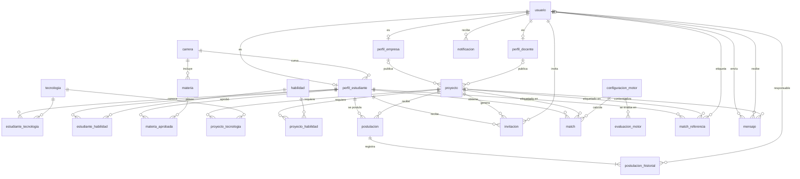
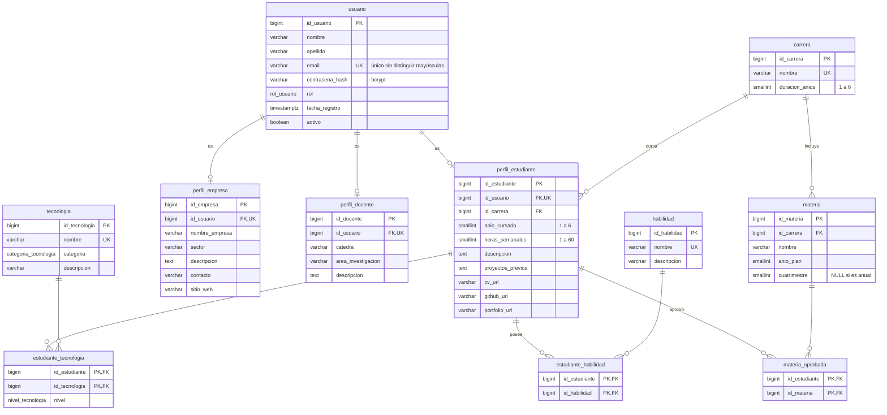
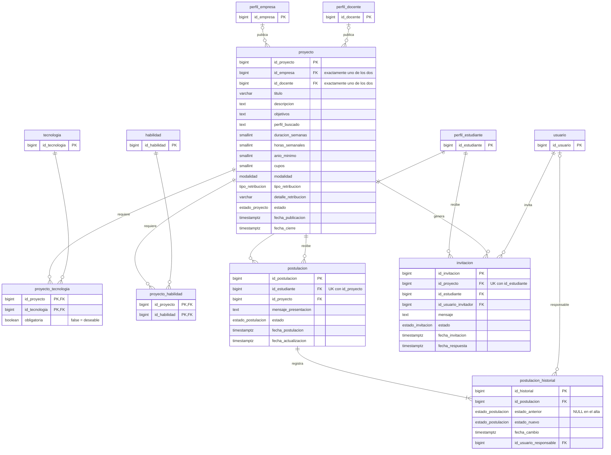
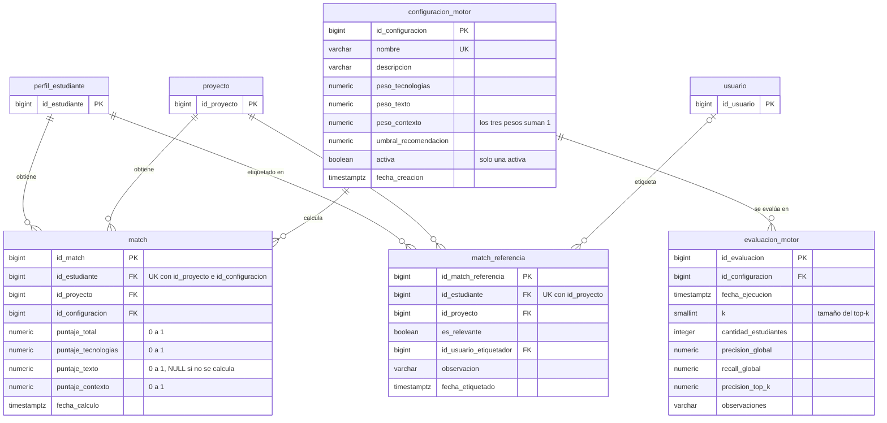
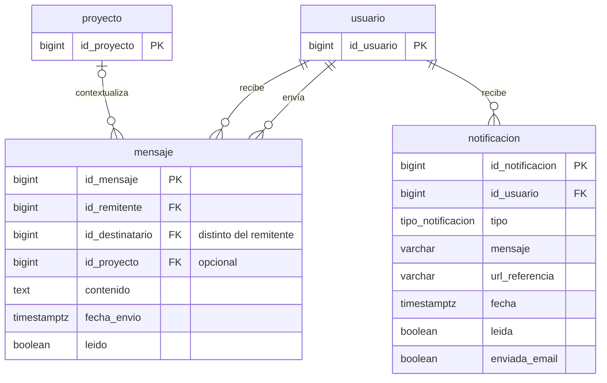
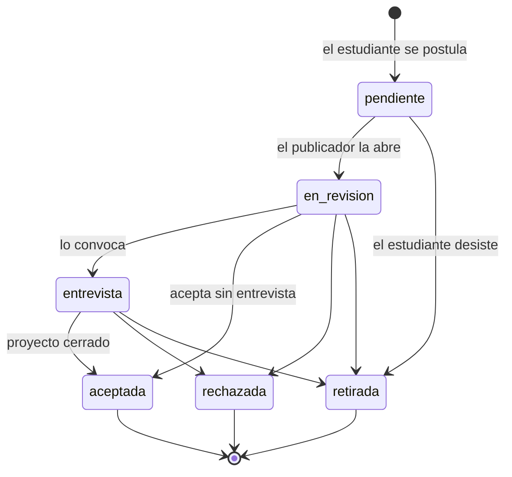

# UTN Match: modelo de datos

Trabajo Final Integrador, Tecnicatura Universitaria en Programación (UTN). Entrega 2: Diseño y Módulos.

## 1. Introducción

UTN Match conecta a estudiantes de la UTN con proyectos acotados que publican empresas y docentes de cátedras. Un motor calcula qué tan compatible es cada estudiante con cada proyecto (el match) y ordena las recomendaciones; el estudiante se postula o el publicador lo invita, y un dashboard mide los resultados. La descripción completa está en el [README](../../README.md).

La base de datos es relacional: PostgreSQL 15 o superior, alojada en Supabase. El esquema está en `backend/database/schema.sql` y tiene 23 tablas, 9 tipos enumerados, 5 triggers y 4 vistas para el dashboard. Los datos de ejemplo están en `backend/database/seed.sql` e incluyen 29 usuarios, 14 proyectos, 24 postulaciones y un conjunto de referencia de 48 pares para evaluar el motor. No se cargan filas en `match` ni en `evaluacion_motor`, porque esos datos los genera el motor.

Las tablas usan los nombres de las entidades de la Entrega 1, en singular y en snake_case. Cada tabla pertenece a un único módulo, que es el único que la escribe. Los demás módulos acceden a sus datos a través de la API del dueño; la única lectura directa entre módulos son las vistas del dashboard (ver [ARQUITECTURA.md](./ARQUITECTURA.md)):

| Área | Tablas | Módulo dueño |
|------|--------|--------------|
| Usuarios y perfiles | `usuario`, `perfil_estudiante`, `perfil_empresa`, `perfil_docente`, `estudiante_tecnologia`, `estudiante_habilidad`, `materia_aprobada` | M1 |
| Catálogos | `carrera`, `materia`, `tecnologia`, `habilidad` | M5 |
| Proyectos | `proyecto`, `proyecto_tecnologia`, `proyecto_habilidad` | M2 |
| Vinculación y motor | `postulacion`, `postulacion_historial`, `invitacion`, `match`, `configuracion_motor`, `match_referencia`, `evaluacion_motor` | M3 |
| Comunicación | `mensaje`, `notificacion` | M4 |

## 2. Diagramas entidad-relación

Los diagramas usan la notación de pata de gallo (Crow's Foot). En cada extremo de una relación, `||` significa exactamente uno, `|o` cero o uno, `|{` uno o muchos y `o{` cero o muchos. El primer diagrama es el DER conceptual, con todas las entidades y sus relaciones. Los siguientes agregan los atributos y están separados por área; cuando una entidad pertenece a otra área, aparece solo con su clave primaria.

### 2.1 Diagrama conceptual

### 2.2 Usuarios, perfiles y catálogos

### 2.3 Proyectos, postulaciones e invitaciones

### 2.4 Motor de recomendación y evaluación

### 2.5 Comunicación

## 3. Diccionario de datos

| Tabla | Descripción | Restricciones principales |
|-------|-------------|---------------------------|
| `usuario` | Datos comunes de toda persona que usa la plataforma (RF-01). | Email único sin distinguir mayúsculas. Solo se guarda el hash bcrypt de la contraseña (RNF-03). |
| `perfil_estudiante` | Carrera, año, horas semanales disponibles, descripción y proyectos previos (RF-02, RF-09). | Uno por usuario, con rol estudiante (trigger). Año de 1 a 6 y horas de 1 a 60. |
| `perfil_empresa` | Empresa u organización que publica proyectos. | Uno por usuario, con rol empresa. |
| `perfil_docente` | Docente o responsable de cátedra que publica proyectos. | Uno por usuario, con rol docente. |
| `estudiante_tecnologia` | Tecnologías del estudiante y su nivel. | Clave compuesta. |
| `estudiante_habilidad` | Habilidades blandas del estudiante. | Clave compuesta. |
| `materia_aprobada` | Materias aprobadas por el estudiante (RF-09). | Clave compuesta. |
| `carrera` | Carreras de la UTN y su duración, para agrupar métricas y validar el año del estudiante. | Nombre único. Duración de 1 a 6 años. |
| `materia` | Materias del plan de cada carrera. | Nombre único dentro de la carrera. |
| `tecnologia` | Catálogo de tecnologías, con categoría. | Nombre único sin distinguir mayúsculas. |
| `habilidad` | Catálogo de habilidades blandas. | Nombre único sin distinguir mayúsculas. |
| `proyecto` | Proyecto publicado por una empresa o un docente (RF-03). | Exactamente un publicador. Fecha de publicación obligatoria fuera del borrador. Fecha de cierre solo si está finalizado o cancelado. |
| `proyecto_tecnologia` | Tecnologías que pide el proyecto, obligatorias o deseables. | Clave compuesta. |
| `proyecto_habilidad` | Habilidades que pide el proyecto. | Clave compuesta. |
| `postulacion` | Postulación de un estudiante a un proyecto (RF-05). | Una por estudiante y proyecto. |
| `postulacion_historial` | Cada cambio de estado de una postulación, con fecha y responsable. | La carga un trigger. |
| `invitacion` | Invitación a un estudiante para un proyecto (RF-05). | Una por proyecto y estudiante. |
| `match` | Puntaje de compatibilidad de un par estudiante-proyecto y sus tres componentes (RF-04). | Una fila por par y configuración. Puntajes entre 0 y 1. |
| `configuracion_motor` | Pesos de cada componente y umbral de recomendación (RF-10). | Los pesos suman 1. Una sola configuración activa. |
| `match_referencia` | Conjunto de referencia: pares etiquetados como buen o mal match, para evaluar el motor (RF-10). | Cada par se etiqueta una vez. |
| `evaluacion_motor` | Resultado de evaluar una configuración (RF-10). | Métricas entre 0 y 1. |
| `mensaje` | Mensaje entre dos usuarios (M4). | Remitente distinto del destinatario. |
| `notificacion` | Aviso por match, invitación, postulación nueva o cambio de estado (RF-08). | `enviada_email` funciona como cola de envío. |

Los tipos enumerados son `rol_usuario`, `modalidad`, `tipo_retribucion`, `estado_proyecto`, `estado_postulacion`, `estado_invitacion`, `tipo_notificacion`, `nivel_tecnologia` y `categoria_tecnologia`; sus valores están en `schema.sql`. El ciclo de vida de una postulación es el siguiente. El estado aceptada equivale a proyecto cerrado y es el último paso del embudo del dashboard.

## 4. Datos que usan el motor y el dashboard

El motor (M3) calcula tres componentes entre 0 y 1 para cada par estudiante-proyecto y los combina con los pesos de la configuración activa: `puntaje_total = peso_tecnologias * puntaje_tecnologias + peso_texto * puntaje_texto + peso_contexto * puntaje_contexto`. Si una configuración no calcula un componente, su peso es 0 y el término no se suma. En v1, el puntaje de tecnologías es el índice de Jaccard (tecnologías en común sobre tecnologías distintas entre los dos) y el de contexto es la proporción entre las horas del estudiante y las del proyecto, con un máximo de 1, multiplicada por 0,5 si el estudiante no llega al año mínimo. La v2 suma la similitud entre los textos del perfil y del proyecto. Los pesos de v1 (0,7 para tecnologías, el dato más concreto del perfil, y 0,3 para contexto) y el umbral de 0,5 son valores iniciales que se ajustan con la evaluación. El resultado se guarda en `match` con sus componentes, para poder explicar cada recomendación.

La evaluación (RF-10) compara los matches de una configuración con el conjunto de referencia (`match_referencia`) y guarda en `evaluacion_motor` la precisión, el recall y la precisión en el top-5. Se calculan solo sobre pares etiquetados: un par sin etiquetar no cuenta como acierto ni como error, y por eso se registran también los no relevantes. El conjunto del seed (31 pares relevantes y 17 no relevantes, 8 de ellos casos límite) fue propuesto con asistencia de IA, y el equipo lo revisa y amplía durante la implementación. Con la fórmula de v1, la precisión da 0,93 y el recall 0,81. El seed trae dos configuraciones para comparar: `v1-tags-contexto` y `v2-tags-texto-contexto`.

El dashboard (M5) usa cuatro vistas. `vw_tecnologias_demandadas` cuenta los proyectos publicados por tecnología y mes. `vw_match_por_carrera_anio` da el porcentaje de estudiantes con recomendación y con proyecto aceptado, por carrera y año. `vw_tiempo_primer_proyecto` calcula los días entre el registro y la primera postulación aceptada. `vw_embudo_postulaciones` cuenta cuántas postulaciones llegan a entrevista y cuántas de esas terminan aceptadas. Las dos últimas dependen de `postulacion_historial`: con el estado actual solamente, no se distingue una postulación rechazada después de una entrevista de una rechazada sin entrevista.

## 5. Decisiones de diseño

### 5.1 Normalización

El modelo está en tercera forma normal. Las tecnologías, habilidades y materias de un estudiante son filas en tablas intermedias, no listas dentro de una columna. En las tablas con clave compuesta, los atributos dependen del par completo: el nivel de `estudiante_tecnologia` describe que un estudiante conoce una tecnología, no a ninguno de los dos por separado. Tampoco hay dependencias transitivas: la carrera y la empresa se referencian por clave foránea, y `horas_semanales` está en el perfil y no repetida en cada franja horaria, como en la Entrega 1. Se descartó guardar las tecnologías en un arreglo o en JSON, porque no permite una clave foránea al catálogo y complica las consultas del dashboard.

### 5.2 Redundancias aceptadas

Hay tres datos que se podrían calcular y aun así se guardan, cada uno escrito por una sola parte del sistema. `postulacion.estado` repite el último registro del historial, pero acelera los listados, y el trigger escribe ambos en la misma transacción. `match.puntaje_total` se deriva de los componentes, pero permite ordenar los rankings con un índice; como los pesos están en otra tabla, no puede ser una columna generada. Las métricas de `evaluacion_motor` se derivan de `match`, pero se guardan porque `match` cambia en cada recálculo y se quieren comparar evaluaciones de distintos momentos.

En cambio, se evitó guardar en la postulación la invitación que la originó. Como `postulacion` e `invitacion` son únicas por el par estudiante-proyecto, la invitación se obtiene uniendo por ese par. Una columna `id_invitacion` habría sido redundante y, sin una clave compuesta, podía apuntar a la invitación de otro estudiante o de otro proyecto; lo comprobamos en la base de prueba antes de quitarla.

### 5.3 Tablas intermedias y claves

Las tablas que solo relacionan dos entidades usan como clave primaria el par de claves foráneas. Las relaciones con ciclo de vida o que otras tablas referencian (`postulacion`, `invitacion`, `match`, `match_referencia`) tienen clave propia y un UNIQUE sobre el par; en `match`, el UNIQUE incluye la configuración, lo que permite comparar v1 con v2. Las claves son `BIGINT IDENTITY` y no UUID: ocupan la mitad y son más legibles, y no necesitamos generar identificadores fuera de la base.

### 5.4 Tipos enumerados y catálogos

Se usa un tipo enumerado cuando los valores son fijos y el código se comporta distinto según cada uno (estados, roles, modalidad), y una tabla catálogo cuando los agrega un administrador (tecnologías, habilidades, carreras, materias).

### 5.5 Publicador del proyecto

Un proyecto lo publica una empresa o un docente. Se usan dos claves foráneas opcionales con un CHECK que exige exactamente una. Así se respetan las entidades de la Entrega 1 y la base garantiza la integridad, a costa de una columna siempre nula. Se descartaron una tabla intermedia "publicador", que agrega un JOIN para solo dos casos, y una clave foránea a `usuario`, que no garantiza el rol.

### 5.6 Triggers, vistas y validación

Los triggers se usan solo para reglas que deben cumplirse aunque alguien modifique la base directamente: registrar el historial de postulaciones, validar que el perfil corresponda al rol del usuario y actualizar la fecha de modificación de la postulación, que usa el historial. Las reglas que dependen del caso de uso quedan en el backend, que las valida en cada operación:

- Las transiciones de estado de la postulación siguen el diagrama de la sección 3, y no se aceptan más postulaciones que los cupos del proyecto.
- Solo se puede postular a proyectos publicados, y la fecha de postulación la fija el servidor.
- Solo el publicador del proyecto puede invitar, y no se invita a un estudiante que ya tiene una postulación en ese proyecto.
- Cuando el estudiante acepta una invitación, el backend crea la postulación en estado pendiente en ese mismo momento. Si la rechaza, no se crea ninguna postulación.
- El año de cursada no puede superar la duración de la carrera, y cada materia aprobada debe pertenecer a la carrera del estudiante.
- No se puede cambiar el rol de un usuario que ya tiene perfil, porque el trigger solo valida al crear el perfil.
 Además, el backend valida primero para dar mensajes claros, y la base vuelve a validar con restricciones; por ejemplo, un CHECK exige fecha de cierre a los proyectos finalizados o cancelados, y solo a ellos. Las métricas se calculan con vistas y no con tablas de contadores, para que siempre coincidan con los datos. Si el volumen crece, se pueden convertir en vistas materializadas sin cambiar sus columnas.

### 5.7 Simplificación

Se revisaron las 25 tablas del primer diseño y se eliminó todo dato que no usara ninguna funcionalidad, métrica ni cálculo del motor. Se quitaron la tabla `disponibilidad` y el tipo `dia_semana`, porque la disponibilidad de RF-02 se cubre con las horas semanales del perfil. También se quitó `token_recuperacion`: la recuperación de contraseña usa un token firmado que deja de valer cuando cambia la contraseña. Se eliminaron `match.estado` y su tipo, que solo servían para una funcionalidad deseable, y cinco columnas sin uso. Entre ellas estaba `proyecto.fecha_creacion`, que se quitó después de comprobar que la métrica de tecnologías demandadas usa `fecha_publicacion`. En la auditoría previa a la entrega se aplicó el mismo criterio: se quitaron las fechas de modificación del perfil y del proyecto (con sus triggers), el estado vencida de las invitaciones y `postulacion.id_invitacion` (ver 5.2). También se había quitado `carrera.duracion_anios`, pero fue un error: es el dato que permite validar que el año de cursada no supere la duración de la carrera, así que se restauró.

Se mantuvo `match_referencia.es_relevante`, en lugar de guardar solo los pares relevantes y suponer que el resto no lo es. La evaluación del motor es la parte central del proyecto, y preferimos registrar explícitamente los pares no relevantes antes que depender de ese supuesto. Se descartaron otras simplificaciones: unir invitación con postulación distorsiona el embudo, reemplazar el historial por columnas de fecha pierde el orden de los cambios, y RF-02 exige las habilidades.

### 5.8 Baja lógica

Los usuarios no se borran: se desactivan con `usuario.activo`. Los proyectos tampoco se borran: se cancelan. Borrarlos eliminaría en cascada postulaciones, historial y pares de referencia, y con ellos las métricas y la evaluación del motor. Para que la base lo impida, las claves foráneas de `postulacion_historial`, de `match_referencia` y las que apuntan a `configuracion_motor` usan `ON DELETE RESTRICT`: no se puede borrar una postulación con historial, un estudiante o proyecto con pares de referencia, ni una configuración con matches o evaluaciones. Se mantiene el borrado en cascada solo para datos que no tienen sentido sin su dueño, como las tecnologías de un perfil o las de un proyecto.

## 6. Cambios respecto de la Entrega 1

Se conservaron las entidades del modelo presentado en la Entrega 1 (págs. 14 a 18 del PDF), salvo Disponibilidad, que pasó a ser un atributo del perfil. Los cambios corrigen huecos de ese modelo: a Proyecto le faltaba la referencia a quien lo publica, y también las horas semanales y el año mínimo que necesita el motor. La postulación no tenía un estado de entrevista ni un historial, que hacen falta para el embudo del dashboard. La carrera era texto libre, así que se agregaron `carrera`, `materia` y `materia_aprobada`. Además, se agregaron el tipo de retribución y las tablas para evaluar el motor (`configuracion_motor`, `match_referencia` y `evaluacion_motor`), que la Entrega 1 describía en el texto pero no en el modelo. Match conserva su nombre, con el puntaje separado en sus tres componentes. Por último, dos atributos cambiaron de nombre para que sean más claros (`contraseña` pasó a `contrasena_hash` y `duración_estimada` a `duracion_semanas`), y se agregaron atributos que necesitan las funcionalidades de los módulos, como los proyectos previos del estudiante, los cupos del proyecto o el mensaje de presentación de la postulación.

También se corrige una errata del PDF: en la página 12 dice que el backend usa Next.js, pero el resto del documento y el repositorio usan NestJS.

El esquema y el seed se probaron en PostgreSQL 18.3; el detalle está en [PROCESO-IA.md](./PROCESO-IA.md). Al desplegar en Supabase hay que habilitar RLS, porque Supabase expone por su API las tablas del esquema `public` y el acceso debe pasar solo por el backend.
