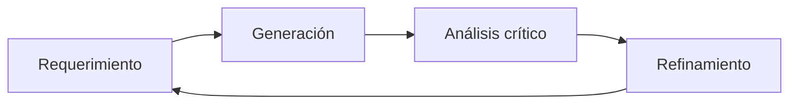

# UTN Match: proceso de modelado asistido por IA

Trabajo Final Integrador, Tecnicatura Universitaria en Programación (UTN). Entrega 2: Diseño y Módulos.

## 1. Forma de trabajo

Usamos un asistente de IA (Claude Code, de Anthropic) sobre el repositorio. La IA exploró el proyecto, propuso alternativas, generó el SQL y la documentación y ejecutó las verificaciones. Las decisiones las tomamos nosotros. Trabajamos en cinco iteraciones, siguiendo en cada una el mismo ciclo: requerimiento, generación, análisis crítico y refinamiento.

## 2. Iteración 1: exploración y plan

Le pedimos a la IA que leyera el repositorio y el PDF de la Entrega 1, y que nos mostrara un plan antes de crear archivos. La IA señaló que la lista de entidades que le habíamos dado no coincidía con el modelo presentado en la Entrega 1, y que seguirla habría vuelto el modelo incoherente con lo ya entregado. También marcó cinco huecos de ese modelo: faltaba el publicador del proyecto, faltaban las horas y el año mínimo que necesita el motor, las horas semanales estaban repetidas en cada franja horaria, no había estado de entrevista ni historial, y la carrera era texto libre. Además encontró una errata en el PDF (backend Next.js en lugar de NestJS).

La IA también afirmó que el modelo de la Entrega 1 estaba "aprobado" por el tutor, algo que no podía saber. Lo corregimos, y en los documentos se describe como "el modelo presentado en la Entrega 1".

Después resolvimos las cuatro cuestiones abiertas que planteó. Mantuvimos `perfil_empresa` y `perfil_docente` con un CHECK de publicador único, en lugar de una tabla de organizaciones, para respetar la Entrega 1. Conservamos el nombre `match`, con sus componentes. Agregamos solo tres requisitos (RF-09 a RF-11). Y sumamos `configuracion_motor` y `evaluacion_motor` en versión simple. También le pedimos marcar qué es MVP y qué es deseable.

## 3. Iteración 2: generación y verificación

La IA generó el esquema, el seed y los documentos. Como no teníamos PostgreSQL instalado, el SQL se probó en PGlite, que es PostgreSQL 18.3 compilado a WebAssembly. Se verificó que el esquema se creara sin errores, que la cantidad de filas cargadas coincidiera con la del seed (un error de tipeo en el seed pierde filas sin avisar) y que las vistas del dashboard dieran resultados coherentes. También se ejecutaron ocho casos que debían fallar, como un proyecto con dos publicadores o una postulación duplicada, y todos fallaron con la restricción esperada. Decidimos no cargar puntajes inventados en `match`, para no falsear la evaluación.

## 4. Iteración 3: revisión con la Unidad 3

Al comparar con el material de la Unidad 3, vimos que faltaban la arquitectura en capas, los contratos de los módulos, el diagrama de paquetes y la justificación del modelo. También fijamos la regla de que M3 obtiene los perfiles a través de la API de M1. Al aplicarla apareció una contradicción: los documentos decían que algunos módulos leían tablas de otros. La corregimos y dejamos las vistas del dashboard como única excepción. Los diagramas se renderizaron para revisarlos, y así encontramos y corregimos errores de presentación.

## 5. Iteración 4: simplificación

Le pedimos a la IA que propusiera qué tablas o columnas se podían eliminar sin perder funcionalidad. Aceptamos quitar `disponibilidad`, `token_recuperacion` y `match.estado`. Las columnas sin uso las eliminamos con una condición: conservar `proyecto.fecha_creacion` si era la única fecha para medir la demanda de tecnologías en el tiempo. Se verificó que esa métrica usa `fecha_publicacion`, así que también se quitó.

Rechazamos la propuesta de eliminar `match_referencia.es_relevante` y suponer que lo no etiquetado es no relevante. Como la evaluación del motor es la parte central del proyecto, preferimos registrar los pares no relevantes de forma explícita. Esa decisión obligó a redefinir las métricas para que se calculen solo sobre pares etiquetados. También justificamos la excepción del dashboard con el principio de la Unidad 3 sobre dependencias claras, pequeñas y estables.

Al aplicar los cambios se corrigieron dos errores más: un reporte que leía tablas de otros módulos y un conteo que la IA había escrito sin medir ("32 y 8", cuando la base daba 31 y 9). Después se repitieron todas las pruebas, y el modelo quedó en 23 tablas.

## 6. Iteración 5: auditoría antes de la entrega

Antes de subir la entrega, le pedimos a la IA una auditoría del repositorio contra cada punto de la consigna, sin modificar nada. El informe marcó que la entrega todavía no estaba en el repositorio remoto y encontró un error que se nos había pasado: `postulacion.id_invitacion` podía apuntar a la invitación de otro estudiante u otro proyecto, y la base de prueba lo aceptaba. También señaló que en el recorte anterior se había perdido el DER conceptual, que el texto de los requisitos solo estaba en el PDF, que quedaban columnas sin uso y que el ejemplo de código hacía depender la capa de aplicación de la librería de eventos, algo que no coincidía con el diagrama de paquetes.

Decidimos eliminar `postulacion.id_invitacion`, porque la invitación se obtiene por el par estudiante-proyecto, y quitar las columnas sin uso con el mismo criterio de la iteración anterior. Además restauramos el DER conceptual, aclaramos la notación, agregamos una tabla corta de requisitos y definimos la interfaz `PublicadorEventos` en el dominio, implementada en Infraestructura. Dejamos sin tocar el código de ejemplo de Next.js y de NestJS, que se reemplaza en el desarrollo. Después se repitieron todas las pruebas y la verificación de coherencia entre el esquema y los documentos.

## 7. Conclusiones

Pedir un plan antes que un resultado nos permitió detectar la incoherencia con la Entrega 1 antes de escribir código. La IA fue útil para encontrar inconsistencias, pero dos veces afirmó datos sin verificarlos, así que todo lo que se puede comprobar hay que comprobarlo. Quedaron de nuestro lado las decisiones de alcance, la interpretación del material de la cátedra y las validaciones que la IA no puede hacer: probar el esquema en Supabase y contrastar las materias del seed con el plan vigente.
