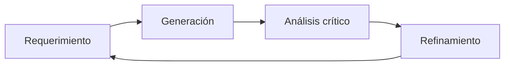

# UTN Match: proceso de modelado asistido por IA

Trabajo Final Integrador, Tecnicatura Universitaria en Programación (UTN). Entrega 2: Diseño y Módulos.

## 1. Forma de trabajo

Usamos un asistente de IA (Claude Code, de Anthropic) sobre el repositorio. La IA exploró el proyecto, propuso alternativas, generó el SQL y la documentación y ejecutó las verificaciones; las decisiones las tomamos nosotros. Trabajamos en seis iteraciones con el mismo ciclo: requerimiento, generación, análisis crítico y refinamiento.

## 2. Iteración 1: exploración y plan

Le pedimos a la IA que leyera el repositorio y el PDF de la Entrega 1 y que presentara un plan antes de crear archivos. Señaló que la lista de entidades que le habíamos dado no coincidía con el modelo de la Entrega 1, marcó cinco huecos de ese modelo (faltaban el publicador del proyecto, las horas y el año mínimo, el estado de entrevista y el historial; las horas se repetían por franja y la carrera era texto libre) y encontró una errata (backend Next.js en lugar de NestJS). También afirmó sin fundamento que el modelo estaba "aprobado" por el tutor; lo corregimos. Decidimos mantener `perfil_empresa` y `perfil_docente` con un CHECK de publicador único, conservar el nombre `match`, agregar solo tres requisitos (RF-09 a RF-11) y sumar `configuracion_motor` y `evaluacion_motor` en versión simple. También pedimos marcar qué es MVP y qué es deseable.

## 3. Iteración 2: generación y verificación

La IA generó el esquema, el seed y los documentos. Como no teníamos PostgreSQL instalado, el SQL se probó en PGlite (PostgreSQL 18.3 compilado a WebAssembly): el esquema se crea sin errores, la cantidad de filas coincide con la del seed y las vistas dan resultados coherentes, y los casos que debían fallar (por ejemplo, un proyecto con dos publicadores) fallan con la restricción esperada. Decidimos no cargar puntajes inventados en `match` para no falsear la evaluación.

## 4. Iteración 3: revisión con la Unidad 3

Al comparar con el material de la Unidad 3 vimos que faltaban la arquitectura en capas, los contratos de los módulos, el diagrama de paquetes y la justificación del modelo. Fijamos la regla de que M3 obtiene los perfiles por la API de M1; al aplicarla, corregimos los documentos que decían que algunos módulos leían tablas de otros y dejamos las vistas del dashboard como única excepción.

## 5. Iteración 4: simplificación

La IA propuso qué tablas y columnas eliminar. Aceptamos quitar `disponibilidad`, `token_recuperacion`, `match.estado` y las columnas sin uso; `proyecto.fecha_creacion` se quitó después de verificar que la métrica de tecnologías demandadas usa la fecha de publicación. Rechazamos eliminar `match_referencia.es_relevante`: preferimos registrar los pares no relevantes antes que suponer que lo no etiquetado es malo, y por eso las métricas se calculan solo sobre pares etiquetados. La IA había escrito un conteo del seed sin medirlo ("32 y 8" en lugar de 31 y 9), y se corrigió.

## 6. Iteración 5: auditoría

Una auditoría contra la consigna mostró que la entrega no estaba en el repositorio remoto y encontró un error: `postulacion.id_invitacion` podía apuntar a la invitación de otro par. La eliminamos, junto con otras columnas sin uso, restauramos el DER conceptual, agregamos una tabla de requisitos y definimos la interfaz `PublicadorEventos` para que la capa de aplicación no dependa de la librería de eventos.

## 7. Iteración 6: revisión como tutor

Una revisión como la de un tutor exigente, con los flujos probados sobre la base, encontró un problema de honestidad: la documentación decía que el conjunto de referencia estaba "marcado a mano por el equipo", pero lo había propuesto la IA. Lo corregimos y agregamos casos límite, porque con casos obvios la evaluación daba 100 %; ahora la precisión de v1 es 0,93. Definimos que aceptar una invitación crea la postulación, adoptamos baja lógica con `ON DELETE RESTRICT` en el historial, el conjunto de referencia y la configuración del motor, y documentamos los cambios de alcance respecto de la Entrega 1. También corregimos un error de la iteración 5: habíamos quitado `carrera.duracion_anios` por no aparecer en ninguna consulta, pero sirve para validar que el año del estudiante no supere la duración de la carrera, así que la restauramos.

## 8. Conclusiones

Pedir un plan antes que un resultado nos permitió detectar la incoherencia con la Entrega 1 antes de escribir código. La IA fue útil para encontrar inconsistencias, pero varias veces afirmó datos sin verificarlos (la aprobación del tutor, un conteo del seed y quién había marcado el conjunto de referencia), así que todo lo que se puede comprobar hay que comprobarlo. También aprendimos que un dato puede no aparecer en ninguna consulta y aun así ser necesario para validar. Quedan de nuestro lado las decisiones de alcance, la revisión del conjunto de referencia, la verificación de las materias del seed contra el plan vigente y la prueba del esquema en Supabase.
